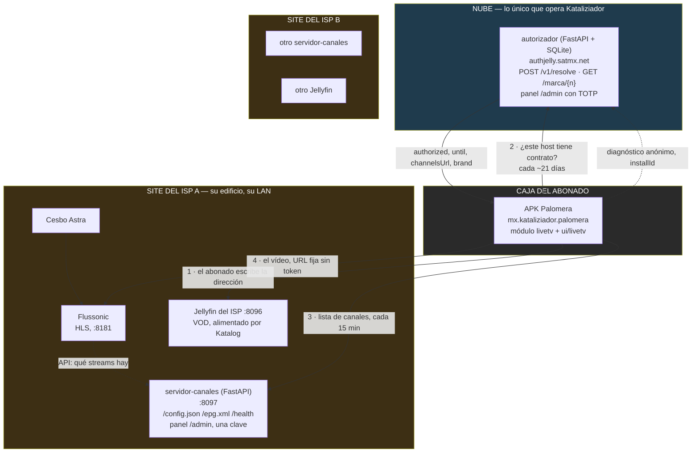

# Auditoría: ¿puede Palco ser una plataforma multi-operador?

**Fecha:** 2026-10-25 · **Alcance:** los tres proyectos que forman el producto
—`jellyfin-livetv-v1` (la APK), `servidor-canales` y `autorizador`—.
**Método:** lectura de código y de los contratos, más lecturas de solo lectura
contra el despliegue de pruebas. **No se modificó código ni datos.**

---

## 0. Tres decisiones tomadas después de esta auditoría

Las tres salieron de leer este documento, así que el diagnóstico de abajo las
precede. Donde una decisión cambia una conclusión, se dice en el sitio en vez
de reescribir el diagnóstico: interesa ver **qué cambió y por qué**.

### Primera decisión: el contenido se queda en el site de cada ISP

**Edgar, 25-oct: «todo el contenido estará en local en cada ISP».** Eso contesta la
pregunta 1, que era la que decidía el resto, y **reduce el trabajo a la mitad
larga**. Lo que se construye no es una plataforma de contenido: es un **plano
de control central sobre infraestructura ajena**.

Lo que esa decisión elimina de golpe:

- catálogo central de canales y títulos, con su `tenant_id`;
- subida de contenido, almacenamiento y su coste;
- **el ancho de banda, que sigue siendo del ISP y nunca tuyo** — y con él el
  cuello de botella del punto 11 y la mitad del riesgo de escalar;
- transcodificación central.

Lo que **no** elimina, y conviene no confundirlo con lo anterior:

- **la pantalla donde el abonado escribe la dirección del servidor** es un
  problema del cliente, no del contenido. Sigue entero;
- **las URLs de stream sin token** siguen siendo el riesgo nº 1. Lo que cambia
  es de quién es el arreglo: lo firma el Flussonic de cada ISP, no uno tuyo;
- **el takedown de un operador** sigue tardando hasta cinco semanas;
- **los roles por operador** siguen sin existir.

### Segunda decisión: el vídeo se normaliza a H.264 + AAC

**Edgar, 25-oct: «sí tendremos que reducir los canales a H.264 + AAC».**
Eso contesta la pregunta 5 y **revierte el principio rector de `CLAUDE.md` §2**
—«los canales se reproducen tal cual llegan del satélite», «el vídeo **nunca**
se transcodifica»— y saca del «fuera de alcance» de §7 la transcodificación de
vídeo en el headend.

Es una marcha atrás legítima, no un error: §2 se escribió cuando el objetivo
era una sola plataforma Android, y el objetivo nuevo es alcance en Smart TV,
donde el MPEG-2 sencillamente no se decodifica. Pero **es una reversión de un
principio fundacional y tiene que escribirse en `CLAUDE.md` con su fecha y su
motivo**, o dentro de dos semanas alguien —yo incluido— volverá a defender el
MPEG-2 porque el documento se lo manda. Ver §6.

**Precisión de alcance, añadida el mismo día:** qué canales entran en el
headend y cuáles se ofrecen **lo decide cada ISP**, no nosotros. Nuestra
decisión es solo con qué códecs los aceptamos.

### Tercera decisión: solo desde la red del ISP

**Edgar, 26-oct: «los abonados solo pueden entrar si están en la red del ISP, no
pueden entrar desde internet; todo el contenido se sirve de un servidor local
y así será por configuración inicial».**

Es la decisión con más consecuencias de las tres, y casi todas buenas.

**Baja el riesgo nº 1 de esta auditoría.** Las URLs de stream permanentes y sin
token eran graves porque quien leyera un `config.json` se llevaba enlaces
reproducibles para siempre. Si el origen solo responde dentro de la red del
ISP, **ese enlace no le sirve a nadie de fuera**. No desaparece —un abonado de
dentro puede redistribuir— pero pasa de «cualquiera en internet» a «alguien
con conexión de ese ISP». Sigue conviniendo firmarlas (§5, Fase 2b), pero deja
de ser lo primero.

**Habilita el descubrimiento por DNS**, que es ahora la mejor opción y cambia
la recomendación de la Fase 2 (ver abajo).

**Y convierte un hueco en un bloqueo:** un revisor de Google está en
California, no en la red de ningún ISP, así que abrirá la app y verá una
pantalla que no conecta con nada. Desde su punto de vista **la app no
funciona**, que es de las causas más comunes de rechazo. No se arregla con unas
credenciales: hace falta un **entorno de demostración accesible desde
internet**. Pasa a la Fase 1 porque bloquea el envío.

**La limitación, dicha en voz alta:** el abonado no ve nada fuera de su casa.
Ni en el móvil en el trabajo, ni en casa de un familiar. Para un producto de
caja de televisión es razonable y simplifica mucho, pero es una promesa que el
comercial del ISP va a vender al revés si nadie se lo dice.

---

### Lo que las tres decisiones dejan en pie

| | Decisión | Qué elimina | Qué deja igual |
|---|---|---|---|
| 1 | contenido en el site del ISP | catálogo central, almacenamiento, ancho de banda, Postgres | la pantalla de servidor, los roles, el takedown de operador |
| 2 | vídeo a H.264 + AAC | el bloqueo de códec para Smart TV | el coste de escribir esos clientes |
| 3 | solo desde la red del ISP | la mayor parte del riesgo de redistribución | la falta de identidad y de roles |

La Fase 2 está reescrita con la primera y la tercera aplicadas, y §6 recoge
entera la segunda. El resto —los doce puntos, los riesgos y el diagnóstico—
vale igual: describe lo que hay, no lo que se quería hacer.

---

## 1. Resumen ejecutivo

**Hoy no es una plataforma multi-operador, y no lo es por decisión de diseño,
no por falta de trabajo.** Palco es una arquitectura **federada**: cada ISP
corre su propio servidor de canales en su propio site, sirviendo sus propios
streams desde su propio Flussonic, con su propio Jellyfin para el VOD
(`CLAUDE.md` §1). Kataliziador no opera contenido: opera **un directorio** —el
registro— con una fila por site que dice si el contrato vive y dónde está el
servicio de ese ISP.

Lo que pides es un producto distinto que comparte la app cliente: **una
plataforma central donde los ISPs suben contenido y el abonado entra con
credenciales que le da su ISP.** La app y los contratos se reaprovechan casi
enteros; el backend **no**, porque el backend actual es «uno por ISP, en el
edificio del ISP».

Hay tres ausencias que no son huecos sino capas completas: **no existe la
identidad del abonado** (el abonado inicia sesión contra el Jellyfin de su ISP,
no contra nosotros), **no existe el plano de contenido central** (no hay tabla
de canales ni de títulos en ningún servicio nuestro) y **no existe protección
de streams** (`CLAUDE.md` §6 lo dice literal: «Auth del contenido: ninguna
(v1)»).

Lo que sí está y vale: una entidad de operador real con contrato y caducidad,
ranuras de marca por operador servidas en caliente, una auditoría
inmodificable, inventario de cajas por operador y diagnóstico por caja. Eso es
andamiaje de operación, y es la parte que normalmente se olvida.

**Estimación honesta: un 25–30 % del camino**, concentrado en el cliente y en
la operación. El 70 % que falta es identidad, contenido y entrega.

---

## 2. Arquitectura actual

### Stack, por componente

| | Tecnología | Dónde vive | Evidencia |
|---|---|---|---|
| APK | Kotlin, Compose, Media3 1.8.0 + libVLC, módulo Gradle `livetv` | caja del abonado | `app/build.gradle.kts`, `livetv/` |
| Registro | Python, FastAPI, **SQLite**, Jinja2, Argon2id, TOTP | nube, nuestra | `autorizador/requirements.in`, `autorizador/db.py:207` |
| Servicio de canales | Python, FastAPI, **ficheros JSON en disco**, Jinja2, scrypt | site del ISP | `canales/app.py`, `canales/acceso.py:61` |
| Origen de vídeo | Flussonic del ISP, HLS/TS, **URLs directas sin token** | site del ISP | `CLAUDE.md` §6 |
| VOD | Jellyfin del ISP | site del ISP | `CLAUDE.md` §6 |
| DRM | **no existe**, fuera de alcance declarado | — | `CLAUDE.md` §7 |

### Modelo de datos

**Registro** (`autorizador/db.py:57-195`), la única base central:

- `sites` — `id, nombre, fin_contrato, activo, channels_url, marca_nombre, marca_acento, marca_logo, mensaje`. **Es la entidad de operador.**
- `alias` — `host → site_id`. Así se sabe de qué ISP es una caja: por el host que el abonado escribió.
- `cajas` — `(site_id, install_id)`, con fabricante, modelo, sdk y última vez.
- `diagnostico` — `(site_id, install_id)`: sesiones, minutos, rebuffers, fallos por canal y por causa.
- `modelos` — inventario de decoders **por modelo**, no por caja, a propósito.
- `usuarios`, `sesiones`, `intentos` — el panel. **`usuarios` no tiene `site_id`.**
- `auditoria` — con `TRIGGER`s que prohíben `UPDATE` y `DELETE` (`db.py:114-117`).

**Servicio de canales:** no hay base de datos. `lineup.json`, `publicado.json`,
`logos/`, `historial/` en un volumen (`docker-compose.yml:22`, `./datos:/data`).
**No hay columna de operador porque la instancia entera es el operador.**

**No existe en ningún sitio:** tabla de abonados, de títulos VOD, de paquetes,
de dispositivos por cuenta, de sesiones de reproducción.

### Flujo de autenticación

1. El abonado **escribe la dirección de su Jellyfin** (`ServerAddFragment.kt`) e inicia sesión ahí. Esa sesión es la puerta a toda la app, VOD y canales.
2. La APK toma el host de esa sesión (`LiveTvCatalog.kt:236`) y pregunta al registro: `POST /v1/resolve` (`autorizador/app.py:235`).
3. El registro responde `authorized`, un `until`, el `channelsUrl` y la marca (`autorizador/autorizacion.py:32-63`).
4. La APK pide `GET {channelsUrl}/config.json` **sin autenticación** (`canales/app.py:82`) y refresca cada 15 min (`LiveTuning.CONFIG_REFRESH_INTERVAL_MS`).
5. Reproduce la URL de Flussonic tal cual viene, **sin token y sin caducidad**.

---

## 3. Los doce puntos

| # | Punto | Estado | Evidencia | Riesgo | Esfuerzo |
|---|---|---|---|---|---|
| 1 | Modelo de tenant | ⚠️ Parcial | `autorizador/db.py:60` | Medio | **M** |
| 2 | Aislamiento de datos | ⚠️ Por topología, no por código | `canales/app.py:82` | **Alto** si se centraliza | **L** |
| 3 | Roles y permisos | ❌ | `autorizador/db.py:78`; `canales/acceso.py:5` | **Alto** | **M** |
| 4 | Autenticación del abonado | ❌ | `ServerAddFragment.kt`; no hay tabla | **Crítico** | **L** |
| 5 | Fuentes de contenido | ❌ | `ServerAddFragment.kt` | **Crítico** | **M** |
| 6 | Protección de streams | ❌ | `CLAUDE.md` §6 | ~~Crítico~~ → **Alto**, acotado por §0.3 | **M** |
| 7 | Kill switch / takedown | ⚠️ Desigual | ver abajo | **Alto** | **M** |
| 8 | Marca por operador | ✅ | `autorizador/autorizacion.py:50-60` | Bajo | — |
| 9 | Gestión desde el panel | ⚠️ | `canales/panel.py` | Medio | **L** |
| 10 | Métricas para facturar | ⚠️ | `autorizador/db.py:118,180` | Medio | **M** |
| 11 | Escalabilidad | ⚠️ Hoy sí, mañana no | `autorizador/db.py:207` | Medio | **L** |
| 12 | Tiendas | ⚠️/❌ | `PLAY.md`; no hay términos | ~~Alto~~ → **Bloqueante** por §0.3 | **M** |

### 1 · Modelo de tenant — ⚠️ Parcial

`sites` **es** una entidad de operador de verdad: tiene nombre, fin de contrato,
interruptor de activo, marca y puntero al servicio (`autorizador/db.py:60-68`).
`cajas` y `diagnostico` llevan `site_id` con `ON DELETE CASCADE`.

Lo que **no** tiene dueño porque no existe centralmente: canales, títulos,
paquetes, abonados, dispositivos-por-cuenta. Los canales viven en el
`lineup.json` de cada instancia y **no llevan ni pueden llevar `tenant_id`**:
la instancia es el tenant.

### 2 · Aislamiento de datos — ⚠️ por topología

**No hay riesgo de fuga entre operadores hoy, y la razón incómoda es que no hay
nada compartido que filtrar.** Dos ISPs no comparten proceso, ni base, ni
disco, ni máquina. Eso es aislamiento físico, que es el más fuerte que existe —
y también significa que **no hay una sola línea de código con `scope` por
tenant que reaprovechar** el día que centralices.

Lo que sí es un hallazgo: **`/config.json`, `/epg.xml` y `/health` no piden
autenticación** (`canales/app.py:82,92,101`). Cualquiera que alcance el puerto
8097 se lleva el lineup completo con las URLs de stream. Hoy es LAN del ISP y
no hay secretos; centralizado sería un volcado del catálogo.

Logos y pósters: los logos se sirven desde el propio site
(`canales/logos.py`) y la marca desde el registro (`/marca/{nombre}`), sin
ruta por tenant en el nombre del archivo — `canal22sd-01368f50.png` lleva un
hash, no un operador.

### 3 · Roles y permisos — ❌

**No existe el rol «admin de operador».** En el registro, `usuarios`
(`autorizador/db.py:78-87`) **no tiene `site_id`**: todo el que entra al panel
ve y edita todos los sites. En el servicio de canales no hay usuarios en
absoluto —**una sola contraseña compartida por site**
(`canales/acceso.py:5-9`)—, lo que además hace imposible atribuir un cambio a
una persona.

Hoy no muerde porque los dos paneles son nuestros. En cuanto un ISP entre a
administrar lo suyo, muerde el primer día.

### 4 · Autenticación del abonado — ❌

**No hay abonados en Palco.** El abonado se autentica contra el **Jellyfin de
su ISP**, y el operador se deduce del host que escribió (`alias` →
`site_id`). No hay código de operador, ni selección en la app, ni dominio
propio: hay una dirección IP o un nombre que el ISP le dictó por teléfono.

**No hay límite de dispositivos ni de sesiones concurrentes** en ninguna parte
de los tres proyectos. Buscado explícitamente, no existe.

### 5 · Fuentes de contenido — ❌ (y es el hallazgo que más te va a doler)

**La primera pantalla de la app es una caja de texto donde el abonado escribe
la dirección de un servidor** (`ServerAddFragment.kt`, heredado del upstream).
Eso es exactamente la «fuente arbitraria» que quieres prohibir: cualquiera
puede apuntar Palco a su propio Jellyfin y usar la app como cliente genérico.
`CLAUDE.md` §8 ya lo reconoce y lo acepta para v1 («el daño es bajo —es su
instalación—»), pero esa aceptación se tomó para otro producto.

Lo que **sí** está bien cerrado: los sustitutos de URL del menú de desarrollo
—`configUrlOverride` y `registryUrlOverride`— viven solo en
`SharedPreferences`, no hay `BroadcastReceiver` que los fije desde fuera, y el
menú entero está detrás de `BuildConfig.DEBUG` (`LiveTvFragment.kt:396`). En la
APK de release **no se llega a ellos**.

### 6 · Protección de streams — ❌

URLs fijas, planas, sin token y sin caducidad:
`http://192.168.11.250:8181/<stream>/index.m3u8`. `CLAUDE.md` §6 lo declara:
«Auth del contenido: ninguna (v1)». No hay proxy ni restream —la caja va
directa al Flussonic del ISP— y DRM está fuera de alcance (§7).

Consecuencia concreta: quien lea un `config.json` se lleva URLs reproducibles
para siempre, en VLC, sin la app.

**La tercera decisión de §0 lo acota, y esto era una suposición que ahora es
política.** El diagnóstico decía «hoy está contenido porque todo ocurre dentro
de la LAN del ISP», lo cual era una descripción del despliegue de pruebas, no
una garantía. Al decidirse que el contenido **solo** se sirve en local y por
configuración inicial, la contención pasa a ser una propiedad del producto: un
enlace filtrado no le sirve a nadie fuera de esa red.

Lo que queda, y por lo que sigue mereciendo arreglarse: un abonado de dentro
puede redistribuir a otros abonados de ese mismo ISP, y el editor de la ficha
eres tú. Las URLs firmadas de la Fase 2b lo cierran, y ahora son trabajo
importante en vez de urgente.

### 7 · Kill switch y auditoría — ⚠️, y muy desigual

| Qué apagar | Mecanismo | Cuánto tarda en llegar |
|---|---|---|
| Un **canal** | `unavailable: true` en `config.json` (`CONFIG_SCHEMA.md:229`) | **≤ 15 min** ✅ |
| Un **operador** | `activo=0` o `fin_contrato` en el registro | **hasta ~5 semanas** ❌ |
| Un **título VOD** | — | **no existe** ❌ |

Los 21 días salen de `AUTORIZADOR_VENTANA_DIAS` (`autorizador/config.py:37`) y
los 14 de gracia de `LiveTuning.REGISTRY_GRACE_MS`. Y hay una regla que lo
empeora a propósito: **si el registro no contesta y la autorización sigue viva,
se entra** (`CLAUDE.md` §6). Está bien razonada —un fallo nuestro no puede
apagar televisiones— pero es incompatible con «quítalo hoy» de un takedown.

**Auditoría:** el registro tiene una de verdad, con `TRIGGER`s que prohíben
editarla y borrarla (`autorizador/db.py:103-117`). El servicio de canales tiene
`historial` por canal (`canales/historial.py`) pero **sin quién**, porque la
contraseña es compartida.

### 8 · Marca por operador — ✅

Lo único que está completo. `marca_nombre`, `marca_acento` y `marca_logo` en
`sites`, servidos en `/v1/resolve` (`autorizador/autorizacion.py:50-60`), con
ranuras cerradas y validación de contraste (`CLAUDE.md` §8). Sin recompilar y
sin tocar la caja. El site de pruebas tiene `brand: null` y la app cae a la
marca neutra, que es el camino previsto.

### 9 · Gestión desde el panel — ⚠️

El panel del site (`canales/panel.py`) permite al operador canales, grupos,
logos, liga de la guía, marca y un aviso a los abonados — autónomo de verdad.
Pero: **no gestiona abonados** (`/admin/abonados` es el aviso en pantalla, no
cuentas), **no hay paquetes** y **no hay API para cobranza ni para Sattanas**.
Y vive en el site, así que dárselo a un ISP es darle acceso a una máquina de su
edificio, no a un panel en la nube.

### 10 · Métricas para facturar — ⚠️

Hay lo suficiente para contar cajas, no para facturar abonados:
`cajas (site_id, install_id, fabricante, modelo, sdk, ultima_vez)` y
`diagnostico` con sesiones, minutos y rebuffers (`autorizador/db.py:118,180`).
Falta: abonados (no existen), ancho de banda (no lo transportamos) y consumo
por título. El `installId` es **opaco por instalación** y `CLAUDE.md` §8 exige
que no se convierta en dato de abonado — si lo usas para facturar por usuario,
cruzas esa línea y cambia el aviso de privacidad y el formulario de Play.

### 11 · Escalabilidad — ⚠️ hoy sí, mañana no

SQLite y un FastAPI de un proceso están bien dimensionados **para el diseño
actual**: una caja pregunta al registro una vez cada tres semanas, así que
50 operadores × 5 000 cajas son **~11 900 peticiones al día**: unas 8 por
minuto. Nada.

Bajo el modelo que propones cambia todo: login por abonado, emisión de tokens
por reproducción y **tú transportando el vídeo**. Ahí SQLite se queda corto por
escrituras concurrentes y el ancho de banda pasa de cero a ser tu principal
coste. No es que el código escale mal: es que hoy no hace ese trabajo.

### 12 · Preparación para tiendas — ⚠️/❌

- **El riesgo de tienda es la pantalla de servidor**, el mismo del punto 5: una app donde el usuario teclea una dirección y reproduce lo que haya se lee como reproductor genérico. Google Play lo tolera —Jellyfin está publicado— pero LG y Samsung son más estrictas, y además contradice tu propio requisito.
- **Política de privacidad:** redactada y verificada contra el código (`AVISO_PRIVACIDAD.md`), **sin publicar** y le faltan cinco datos (`PLAY.md` §4).
- **Términos de uso:** ❌ no existen. Buscado en todo el repositorio.
- **Contacto para reportes de derechos:** ❌ no existe.
- **Login de demostración para revisores:** ❌ no existe, y con la tercera decisión de §0 **pasa de hueco a bloqueo**. El revisor está en California, no en la red de ningún ISP: abrirá la app y verá una pantalla que no conecta con nada. «La app no funciona» es de las causas más comunes de rechazo, y no se arregla entregando credenciales — hace falta el entorno de demostración de la Fase 1.
- **Oferta de código GPL-2.0:** incompleta — la pantalla de Información dice que el código existe pero no dónde (`PLAY.md` §5).
- Lo que sí está: paquete propio, nombre e icono propios, «no afiliado a Jellyfin», 64 bits, `targetSdk` 36, sin `debuggable`.

---

## 4. Riesgos de seguridad, por severidad

**El orden es el del diagnóstico, anterior a la tercera decisión de §0.** Con
el contenido alcanzable solo dentro de la red del ISP, el nº 1 queda acotado y
el orden real pasa a ser **2, 3, 1, 4, 5, 6**: lo que más pesa deja de ser la
redistribución y pasa a ser que **no hay identidad de abonado, así que no hay
nada que revocar**. Se deja la numeración original para que se vea qué cambió
y por qué, no porque siga valiendo.

**1 · Las URLs de stream son permanentes y públicas.** Quien lea un
`config.json` —que no pide autenticación— se lleva enlaces reproducibles sin la
app y sin caducidad. Contenido de terceros redistribuible por copiar y pegar.

**Acotado por la tercera decisión de §0**, y es la razón por la que ya no lo
pondría el primero: si el origen solo responde dentro de la red del ISP, el
enlace filtrado no le sirve a nadie de fuera. Queda el abonado de dentro que
redistribuye, que es un problema real pero de otro tamaño, y se cierra con
URLs firmadas (Fase 2b). **Lo que no cambia es que el riesgo, cuando se
materializa, sigue siendo tuyo y no del ISP**, porque el editor de la ficha
eres tú.

**2 · No hay identidad de abonado, así que no hay nada que revocar.** No puedes
cortar a un moroso, ni limitar dispositivos, ni saber cuántas personas hay
detrás de una cuenta. El único corte disponible es apagar al operador entero.

**3 · El takedown de un operador tarda hasta cinco semanas.** Y la regla «si el
registro no contesta, se entra» significa que una caja sin internet sigue
reproduciendo indefinidamente mientras alcance la LAN del ISP.

**4 · Un solo rol en los dos paneles.** Cualquier cuenta del registro administra
todos los sites; el panel del site es una contraseña compartida sin atribución.
El día que entre un ISP, no hay forma de limitarlo ni de saber quién cambió qué.

**5 · El cliente acepta cualquier servidor.** Un usuario puede usar Palco contra
infraestructura que no controlas, y tu marca queda asociada a lo que sea que
sirva ese servidor.

**6 · `/config.json` y `/health` abiertos.** `/health` además revela nombres de
streams, estado del headend y errores de configuración. Útil para operar,
innecesario para el mundo.

**Lo que NO encontré, y lo digo porque se suele asumir lo contrario:** ningún
secreto en el repositorio de la APK ni en sus 189 commits, contraseñas del panel
con Argon2id y TOTP en el registro y scrypt en el site, protección CSRF y de
origen en los dos paneles, y una auditoría que el propio motor de base impide
borrar. **La higiene está bien; lo que falta son capas, no parches.**

---

## 5. Plan por fases

### Fase 1 — Un segundo ISP piloto, sin cambiar el modelo

El objetivo es demostrar que dos operadores conviven. **No requiere centralizar
nada**, y por eso es barata: hoy «dar de alta un ISP» ya es instalarle el
servicio y añadir una fila.

- **Datos:** añadir `site_id` a `usuarios` del registro y un rol (`superadmin` / `operador`) — `autorizador/db.py`, una migración nueva, nunca editando una desplegada.
- **Endpoints:** filtrar por `site_id` todas las vistas de `/admin/*` cuando el usuario sea de operador; hoy no hay un solo filtro.
- **Panel del site:** usuarios con nombre en vez de una contraseña compartida, para que `historial` pueda decir quién.
- **Takedown:** bajar `AUTORIZADOR_VENTANA_DIAS` y añadir un camino de corte rápido —que la APK revalide al arrancar la sección, no solo al caducar—. Esto **sí** toca la APK y es un cambio de contrato (`REGISTRY_SCHEMA.md`).
- **Legal:** publicar el aviso de privacidad, escribir términos de uso y poner un contacto de reportes de derechos.
- **Entorno de demostración accesible desde internet — bloquea el envío a Play.** Sube a Fase 1 por la tercera decisión de §0: con el contenido solo alcanzable dentro de la red del ISP, un revisor no puede ver **nada**, y «la app no funciona» es de las causas más comunes de rechazo. Hace falta un Jellyfin pequeño, un servidor de canales y uno o dos streams **con contenido propio o libre de derechos**, dados de alta como un ISP más en el registro, con usuario y clave entregados en el formulario de envío. No es trabajo perdido: ese mismo entorno sirve para las capturas de la ficha, para enseñar el producto a un ISP nuevo sin tocar el de nadie, y para probar las altas.
- **Apps:** ninguna además de lo anterior.

### Fase 2 — Operación con varios ISPs, con el contenido en su site

Con el contenido quedándose en cada ISP, esta fase deja de ser «construir una
plataforma» y pasa a ser **cerrar el cliente y acelerar el corte**. Tres cosas,
en este orden.

**a) Quitar la pantalla de servidor. DNS primero, código de operador como
respaldo.** Es el cambio de más valor por lo que cuesta, porque resuelve tres
cosas a la vez: la fuente arbitraria (punto 5), el mayor riesgo de tienda
(punto 12) y el «el abonado solo entra con lo que le dio su ISP» del enunciado.

**Primer intento, DNS.** La tercera decisión de §0 lo habilita: si la caja está
siempre en la red del ISP, la app puede preguntar por un **nombre fijo** —
`palco.servicio`, pongamos— y **el resolvedor del ISP contesta con su
servidor**. El abonado no escribe nada. Para el ISP es **un registro DNS**, que
es más simple que cualquier panel que le demos y algo que ya hace todos los
días.

La pega, y es frecuente: **falla si la caja no usa el DNS del ISP.** Muchas
Android TV traen `8.8.8.8` puesto o un DNS privado configurado. Por eso es el
camino rápido, no el único.

**Respaldo, el código de operador.** Si el nombre no resuelve, se pide un
código corto. Y **ese código ya existe**: `sites.id` del registro tiene el
formato `^[a-z0-9][a-z0-9-]{0,39}$` (`autorizador/db.py:213`), o sea `redtv`,
`ispjelly`. No hay espacio de nombres nuevo que inventar ni gestionar — solo
enseñarlo en el panel, porque hoy es un detalle interno.

**Variante que recomiendo para el respaldo:** meter el código en el propio
usuario, `juan@redtv`. Cuesta lo mismo, el abonado escribe **dos campos en vez
de tres** y le suena a correo. El ISP no cambia nada: crea el usuario `juan` y
le dice que es `juan@redtv`. Se parte por la **última** arroba y se exige que
el sufijo tenga forma de código; si no la tiene, se trata todo como nombre de
usuario, que cubre el caso del usuario que es un correo.

**Qué hay que tocar:** `sites` no tiene columna para la URL de Jellyfin —nunca
hizo falta, la traía el abonado—, así que una migración; `Pregunta.host` pasa
de obligatorio a opcional y se acepta `siteId`; la respuesta añade
`site.jellyfinUrl`. Una APK vieja sigue mandando `host` y funciona igual, que
es lo que los contratos exigen.

Y fíjate en lo que **no** hace falta: identidad central. Las credenciales
siguen siendo las que el ISP da en su Jellyfin, que es exactamente lo que
pides. No hay tabla de abonados que mantener, ni sincronizar, ni respaldar.

**El coste real es uno:** metes al registro en el camino del primer arranque.
Hoy, si se cae, las cajas instaladas siguen funcionando porque la dirección ya
está puesta; con el código, una caja **nueva** no puede empezar. El radio es
acotado —nunca afecta a quien ya funciona— pero se diseña desde el principio:
cachear la resolución en cuanto llega, permitir reintroducir el código, y
distinguir «vuelve a intentarlo» de «no autorizado», que hoy se confundirían.

**Migración de lo ya instalado:** no migrar. Que la app siga aceptando el
servidor ya configurado y que lo nuevo sea solo para altas. Si algún día
quieres unificar, la app puede resolver el host contra el registro y rellenar
el código sola.

**b) URLs de stream firmadas, en el Flussonic de cada ISP.** Flussonic las
soporta; el trabajo es configuración de headend más que el generador del
`config.json` emita URLs con token y caducidad corta en vez de fijas. Esto es
lo que convierte «quien lea el config se lleva el canal» en «quien lea el
config se lleva un enlace que caduca». **Es el arreglo del riesgo nº 1**, y
ahora es replicable site por site en vez de un proxy central.

**c) Corte rápido de operador.** Que la APK revalide al entrar a la sección y
no solo cuando caduca, y bajar `AUTORIZADOR_VENTANA_DIAS`. Es un cambio de
contrato (`REGISTRY_SCHEMA.md`) y hay que medir el coste: cada entrada a la
sección pasa a depender de que el registro conteste, y la regla «si no
contesta, se entra» existe por buenas razones. **Mi recomendación es
mantenerla** y conseguir la rapidez por el otro lado: el takedown que de verdad
importa es el de un canal o un título, y ese ya llega en 15 minutos.

**Lo que queda sin resolver aunque hagas las tres**, y es honesto decirlo:

- **el takedown de un título VOD no es tuyo.** El VOD es el Jellyfin del ISP,
  alimentado por Katalog. Quitarlo es una acción en su site o en Katalog, no en
  un panel tuyo. Si necesitas poder hacerlo tú, eso **sí** es trabajo nuevo y
  no estaba en esta auditoría;
- **el límite de dispositivos por cuenta.** Si lo quieres, lo natural es
  apoyarse en la gestión de sesiones del propio Jellyfin antes de escribir una
  tuya. **No lo verifiqué**: no está en estos tres repositorios;
- **la base del registro.** Con el contenido fuera, SQLite se queda bien
  dimensionada: sigue siendo una pregunta por caja cada tres semanas. Postgres
  deja de ser necesario, y eso es dinero y complejidad que te ahorras.

### Fase 3 — Tiendas de Smart TV

- **El bloqueo de códec queda levantado por la segunda decisión de §0**: con el vídeo normalizado a H.264, las tres plataformas pueden reproducir el lineup. Lo que **no** se levanta es el coste del cliente: reescribirlo para webOS y Tizen **no reaprovecha código** de Android más allá de los contratos JSON. Son dos clientes nuevos, no dos compilaciones.
- **Y queda la consecuencia de §6.7:** si la normalización es parcial, los canales que sigan en MPEG-2 se ven en Android y no en el Smart TV, o sea **un lineup distinto por plataforma**. Es un problema de producto y de soporte, y se decide antes de empezar, no después.
- Login de demostración permanente para revisores, con un operador de prueba y contenido propio o libre de derechos.
- DRM: ninguna tienda lo exige por sí sola, pero un titular de derechos sí puede. Hoy está fuera de alcance y es una decisión comercial.

---

## 6. La normalización a H.264: lo medido y lo que hay que decidir antes

### 6.0 Lo medido, que puede cambiar el tamaño del problema

Antes de dimensionar nada, se pidió el **master playlist** de cinco streams del
Flussonic de pruebas — solo la cabecera, sin descargar vídeo:

| stream | resolución | códecs declarados |
|---|---|---|
| `espnsur4abr` | 576p **y** 720p | `avc1.640020, mp4a.40.2` |
| `espnsur1abr` | 576p **y** 720p | `avc1.640020, mp4a.40.2` |
| `canal22sd` | 1044x576 | `avc1.64001f, mp4a.40.2` |
| `oncesd` | 1044x576 | `avc1.64001f, mp4a.40.2` |
| `test-sat77w-estrellassd-mp2v` | 640x480 | `mp4a.40.2` — **sin códec de vídeo** |

**Los cuatro primeros ya son H.264 + AAC.** No por casualidad: `1044x576` no es
una resolución que salga de un satélite, y los `-abr` traen dos calidades de
plantilla de Flussonic. **Ya están transcodificados.** El quinto es el stream
de pruebas de paso directo —lleva `-mp2v` en el nombre— que se montó para tener
un caso MPEG-2 contra el que desarrollar.

Encaja con lo anotado el 03-oct contra producción: **la mayoría de los 44
streams vivos usan plantillas `*-ABR`** (`LIVETV_LOG.md`, entrada del 03-oct).

**Cinco muestras, leídas una vez, no un censo** — y leídas del headend de
pruebas, no del de un ISP. Pero apunta a que la pregunta no es «¿puedo
permitirme transcodificar 120 canales?» sino **«¿cuántos faltan?»**, y puede que
sean pocos.

**Recomendación 0, antes que ninguna otra: saca el censo completo por la API de
Flussonic** (`/streamer/api/v3/streams`, que el servicio de canales ya consume
en `canales/flussonic.py:114`) y cuenta cuántos streams **no** son H.264. Esa
consulta necesita las credenciales del headend. No dimensiones una granja de
transcodificación para 120 canales si ya tienes 100 corriendo.

### 6.1 Escribir la marcha atrás en `CLAUDE.md` antes de tocar código

§2 y §7 dicen hoy lo contrario de lo decidido. Mientras no se corrijan, el
documento manda y cualquiera que lea el repositorio defenderá el MPEG-2. Es lo
más barato de esta lista y lo más fácil de saltarse.

### 6.2 El H.264 va a fallar igual de callado que el AAC, y no hay alarma

§2 ya documenta esta avería para el audio: la normalización **es un requisito de
despliegue, no una garantía**, se cumple en los sites bien configurados y falla
en silencio en los demás. La defensa que se construyó es la línea
`audio.noNormalizado`.

**No existe el equivalente para vídeo.** Y falla peor: audio mal normalizado da
silencio en una caja sin decoder; vídeo mal normalizado da **pantalla negra**.
En cuanto el H.264 sea requisito de despliegue, hace falta un
`video.noNormalizado` con el mismo papel. Es barato y es trabajo de la APK.

### 6.3 No quitar libVLC todavía — y la precisión que importa

**Quitar libVLC no quitaría el soporte de MPEG-2.** La cascada
(`LIVETV_ENGINE.md` §4.2) lo resuelve en el **paso 1** con el decoder de la
plataforma; la caja de pruebas trae `OMX.amlogic.mpeg2.decoder.awesome2` por
hardware. libVLC es el **paso 3** y solo se alcanza en una caja **sin** decoder
MPEG-2. Lo que aporta en concreto son dos cosas: MPEG-2 en cajas que no lo
traen, y **desentrelazado por software de SD**.

| | |
|---|---|
| **Lo que cuesta tenerlo** | **19,5 MB de los 37** que descarga una caja (`PLAY.md` §2), más el mantenimiento de un segundo motor —que no es teórico: el `frames.first` que medía la superficie creada en vez de una imagen, y el pendiente 83, abierto— |
| **Lo que compra** | que un site mal configurado se siga viendo, que es exactamente la avería de §6.2 |

**Recomendación: se queda.** Y la asimetría decide: quitarlo más tarde es
trivial; volver a meterlo después de publicar es una versión nueva pasando por
revisión de Google. **El momento de revisarlo es cuando un censo enseñe cero
MPEG-2 sostenido en todos los sites**, no cuando se anuncie la política.

### 6.4 Decidir el entrelazado en la misma conversación

Si se transcodifica, **sacar progresivo**. H.264 admite entrelazado y muchos
decoders lo tratan mal. Hacerlo una vez en el headend retira toda la cascada de
desentrelazado y la maquinaria de `forzarDesentrelazado` del menú. Si no se
decide explícitamente, sale H.264 entrelazado y se paga **la complejidad y el
transcodificado**.

### 6.5 La cadencia, que puede retirar lo más frágil de la pila

El pendiente 24 midió que el **decodificador AVC de Amlogic ignora el pulldown
3:2**, y ese es el único motivo por el que el tunneled está encendido de
fábrica (`CLAUDE.md` §6) — la función que más depende del fabricante de todo lo
que hay, y la que más riesgo trae en una flota de cajas desconocidas. **Si el
headend saca cadencia constante, el problema puede desaparecer en origen.**
Merece medirse antes de publicar a cajas que no conocemos.

### 6.6 Que esto no bloquee Play

La decisión de transcodificar es trabajo de headend que se mide en meses.
Publicar es el **único instrumento** para medir la ZTE B866V2, que es la caja
mayoritaria del cliente y solo instala desde la ficha pública (`PLAY.md`). Son
independientes: **publicar primero**.

### 6.7 Si la normalización es parcial, acabas con dos lineups

Esto sale de la propia precisión de §0: **qué canales entran en el headend lo
decide cada ISP**. O sea que la normalización completa no está garantizada, y
hay exactamente dos finales coherentes:

- **se transcodifica todo** → no quedan canales MPEG-2, los tres clientes de
  Smart TV ven el lineup entero, y libVLC pasa a ser seguro puro contra errores
  de configuración (§6.3), que sigue valiendo;
- **se transcodifica una parte** → los canales que queden en MPEG-2 se ven en
  Android y **no** en Roku, webOS ni Tizen, y el ISP acaba con **un lineup
  distinto por plataforma**.

Lo segundo no es un problema técnico: es de producto y de soporte. El abonado
llama preguntando por qué su tele no tiene el canal 102 y la caja de su hijo
sí. Conviene decidirlo antes de empezar la Fase 3, y si se admite, **el
`config.json` tendría que poder decir qué canales son aptos para qué
plataforma** — y eso es un campo nuevo en el contrato, no una opción de
despliegue.

**Recomendación: si se transcodifica, completo.** A medias se paga el coste del
headend y se mantienen igualmente las dos pilas de decodificación.

### 6.8 Ver una vez lo que cuesta en calidad

El satélite ya entrega comprimido; transcodificar encima es una segunda
generación, más latencia. Un canal lado a lado en la tele, diez minutos, antes
de comprometer 120. **No hay ninguna medida de esto hoy.**

---

## 7. Preguntas que necesito que contestes

1. ~~**¿El contenido se sube a tu plataforma o se queda en el site del ISP?**~~ **Contestada el 25-oct: se queda en el site de cada ISP.** Ver §0.
2. **¿Los ISPs mantienen su Jellyfin?** Si sí, hay dos identidades conviviendo —la de Jellyfin y la tuya— y hay que decidir cuál manda. Si no, hay que escribir el VOD entero.
3. **¿Cuánto puede tardar un takedown?** «El mismo día» y «≤ 5 semanas» llevan a arquitecturas distintas. Si tiene que ser el mismo día, la caja tiene que preguntar al arrancar y eso quita la tolerancia a que el registro se caiga.
4. **¿Los ISPs administran lo suyo, o lo administras tú para ellos?** Decide si la Fase 1 necesita roles de verdad o basta con que sigas entrando tú.
5. ~~**¿Hay compromiso de transcodificar vídeo en el headend?**~~ **Contestada el 25-oct: sí, a H.264 + AAC.** Ver §0 y §6. Qué canales entren lo decide cada ISP.
6. **¿Qué pasa con la GPL-2.0?** El fork obliga a publicar el código, incluido el que comprueba la autorización. Cualquiera puede compilar una versión sin ella. Eso es tolerable mientras el valor esté en el acceso al contenido —por eso la Fase 2 importa— pero no si el control depende de la app.
7. **¿Cuántos operadores y cuántos abonados en 12 meses?** Es lo que decide si Postgres y un proxy de streams son necesarios ya o son prematuros.

---

## 8. Lo que esta auditoría no cubrió

- **No ejecuté las pruebas** de `servidor-canales` ni de `autorizador`: habría sido seguro, pero no añadía evidencia sobre multi-operador.
- **No audité el despliegue en producción** —ni el registro en `authjelly.satmx.net` ni el host del site— más allá de lecturas públicas. Un intento de entrar por consola a `192.168.20.249` fue bloqueado por el entorno, y no insistí.
- **No revisé Katalog**, que alimenta el VOD y que no está en estos tres repositorios.
- **No hay medición de carga de ninguna clase.** Todo lo dicho sobre escalabilidad en el punto 11 es razonamiento sobre el diseño, **no medido**.
